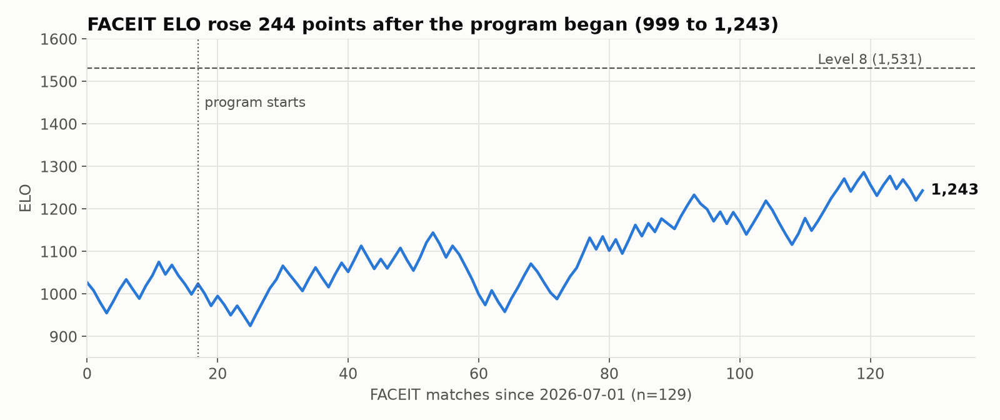
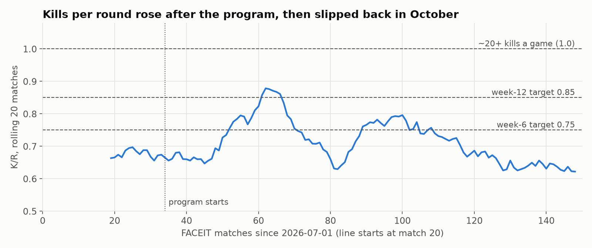

# CS2 Skill vs. Rank

Did a deliberate Counter-Strike 2 training program improve my skill, and did my rank follow?
This repo is a small end-to-end analysis built on my own match data: collection from two APIs,
a reproducible build, SQL, a notebook, and an honest write-up of what the data can and can't say.



## Findings (as of 2026-10-11)

**Rank followed.** FACEIT ELO rose 244 points after the program started on 2026-08-13 (999 →
1,243, Level 4 → 6). Premier went from 12,851 to 15,366.

**Raw aim improved, and the change is real.** Reaction time fell 694 → 641 ms and preaim 11.3° →
10.1°, both with non-overlapping 95% confidence intervals (n = 96 before, 111 since).

**Kills improved, but less clearly.** Kills per round rose 0.65 → 0.71, and games with 20+ kills
went from 9% to 23%. The 95% intervals overlap, so this is suggestive, not proven. Kills also
slipped back to 0.62 in October while ELO kept rising.



**The weaknesses moved from aim to game sense.** Over the same period, CT opening-duel win rate
fell 47% → 40%, teammates flashed per flash rose 0.49 → 0.62 (now equal to enemies flashed),
utility rating fell 70 → 61, and trade-kill success fell 49% → 44%. Those declines became the
[12-week practice plan](docs/improvement-plan.md).

**What this can't tell you.** It's one player with no control group, and the first program was
never logged, so the climb can't be credited to practice. Teammates, queue mix and patch
changes are all live confounders. One teammate appears in 56 of the last 100 matches.

## Data

| Source | What it gives | Access |
|---|---|---|
| [Leetify](https://leetify.com) public API | per-match aim mechanics; aggregate opening-duel, flash, trade and utility stats | no auth, **last 100 matches only** |
| FACEIT Data API v4 | per-match kills, deaths, ADR, K/R for every FACEIT match | free server-side key in `.env` |
| FACEIT stats history | per-match ELO and ELO change | Cloudflare-protected; browser-only backfill |

### The rolling window, and the gap it caused

Leetify's API only ever returns the **last 100 matches**. On day one the window was observed
sliding forward eleven days in nine hours. So `capture.py` saves every response verbatim, and
`build.py` unions all snapshots deduped on match id. **107 of the 207 Leetify matches in this
dataset exist only because a snapshot caught them.**

The daily capture then silently failed from 2026-08-15 to 10-11, for two reasons: cron skips
jobs while a Mac sleeps, and macOS privacy rules block background jobs from reading
`~/Documents`. The repo moved out of `~/Documents`, and capture now runs from a launchd agent that
catches up after sleep. Leetify's aim data for **Aug 15–23 is permanently lost**. FACEIT history
is permanent, so kills and ELO for those 10 matches survive. The gap is reported in the notebook
rather than smoothed over.

## Layout

```
capture.py            daily: Leetify snapshot + FACEIT standing + new FACEIT match stats
build.py              raw snapshots -> tidy CSVs (union, dedupe, time-based join)
query.py              run a sql/ file against the CSVs with DuckDB
log_training.py       log a practice session (the independent variable)
backfill_faceit.py    per-match ELO history via a real browser (Cloudflare)
analysis.ipynb        the findings above, reproducible top to bottom
sql/                  01-02 worked examples, 03-07 open questions
docs/improvement-plan.md   the 12-week plan the findings produced

data/raw/             immutable: leetify/profile-*.json, faceit/{user,stats}-*.json
data/processed/       faceit_matches.csv   one row per FACEIT match (kills, ADR, ELO)
                      matches.csv          one row per Leetify match (aim), FACEIT kills joined
                      profile_stats.csv    one row per snapshot (opening duels, flashes, trades)
                      daily.csv, faceit_elo.csv, training_log.csv, summary.json
```

## Running it

```bash
python3 -m venv .venv && .venv/bin/pip install duckdb pandas matplotlib jupyter requests
echo "FACEIT_API_KEY=<your server-side key>" > .env        # gitignored
python3 capture.py                                         # snapshot now
python3 build.py                                           # rebuild data/processed
.venv/bin/python query.py sql/01_kills_by_period.sql
.venv/bin/jupyter nbconvert --to notebook --execute --inplace analysis.ipynb
python3 log_training.py -m 45 -d demo_review -f opening_duels
```

Daily capture runs from `~/Library/LaunchAgents/com.zuberi.cs2capture.plist` at 21:00, plus at
login. Check it with `launchctl list | grep cs2capture` and `logs/launchd.log`.

## Method notes

- **Joining the two sources.** Leetify and FACEIT use different match ids, so FACEIT kills are
  joined to Leetify matches on finish time (nearest within ±10 minutes). Of 107 FACEIT matches,
  107 match and 0 don't. Unmatched rows are counted, never dropped silently.
- **Mechanics index.** Each mechanic is z-scored against the *pre-program* mean and standard
  deviation, with reaction time and preaim inverted so higher is always better, then averaged.
  The constants are in `summary.json`.
- **Missing values stay missing.** 20 of 308 FACEIT matches have no ELO (non-ELO queues), and
  Premier rank 0 means unranked. Both become blanks, never zeros or interpolations. Imputing a
  rank series would manufacture the very trend under test.
- **Rolling-window stats aren't independent.** `profile_stats.csv` values are Leetify's 100-match
  averages, so consecutive daily snapshots share ~99% of their matches. Before/after comparisons
  use windows that don't overlap.
- **Report n.** Every comparison carries its sample size, and map-level splits under 15 games are
  labeled directional only.

## Tableau

`data/processed/*.csv` load directly into Tableau Public. The intended dashboard:
FACEIT ELO by match (line) · rolling K/R with the 0.75 / 0.85 targets · one bar per Leetify
weakness, August vs. October · practice-block bands from the `practice_block` column.
